# Fee-tier incentive experiment: uplift modelling, incrementality and durability

**Should an institutional exchange tell clients how close they are to a cheaper fee tier, and
give them a discount to get there? For whom does it make money, and for how long?**

An end-to-end causal-inference project on a **simulated** multi-cell randomised experiment over
5,000 institutional clients. It benchmarks uplift models (S/T/X/R/DR meta-learners vs
`CausalForestDML`) on Qini and AUUC, estimates the average effect with CUPED and doubly robust
estimators, decomposes revenue into a volume effect and rate compression, compares a blanket
rollout with an uplift-targeted one, and uses survival analysis to correct the annualised ROI
for effect decay. Every method is graded against the simulator's planted truth, replicated over
40 seeds, and explained in a learning write-up with worked examples and exercises.

> **The data is simulated.** There is no real client data here. A simulator
> (`src/tierlift/simulate/`) generates clients, fee tiers, a stratified three-cell experiment
> and every client's *potential outcomes* under every cell. Its primitive parameters (fee
> schedule, incentive size, how volume responds to it, the weekly lapse rate, noise) are set to
> plausible values from stated assumptions, and the headline effects follow from them. The
> estimators never see the truth; the tables below show the estimate next to the planted truth
> so you can judge each method. `docs/SIMPLIFICATIONS.md` lists what a real exchange would add.
> `docs/DECISIONS.md` (A1–A3) lists every assumption with its rationale and explains why the
> estimators were never tuned to the truth.

## Headline results

The headline numbers are averages over **40 independent simulated experiments** (seeds 0–39,
`tierlift montecarlo`; `results/montecarlo_summary.csv`), each re-simulated and re-analysed from
scratch. One simulated experiment is one draw, so a single run cannot show that a method works;
the spread across 40 can. The figures and per-method tables further down come from one of those
40 runs, seed 13. It was picked by a fixed rule that never looks at the planted truth: the run
whose targeted-band estimate is the median of the 40 (`pick_showcase_seed`, decision A3), so
it is a typical run rather than the best one.

| Question | Method | Over 40 runs: estimate (mean ± SD) | Planted truth (mean over runs) | Seed 13: estimate vs truth |
|---|---|---|---|---|
| How much tighter does CUPED make the ATE? | CUPED with pre-period revenue | **51% ± 3% variance reduction** | not planted: follows from ρ ≈ 0.71 (A2) | 52% (ρ = 0.71); equivalent to 2.2× the sample |
| What happens if everyone gets the incentive? | AIPW (doubly robust), incentive vs holdout | **−2.7% ± 1.3% net revenue**; 95% CIs cover the truth in 95% of runs | −2.9% | −3.4% [−6.0, −0.8] vs −3.0% |
| What if only clients 10–20% below the next tier get it? | AIPW scores averaged over the band (8% of clients) | **+13.0% ± 5.5% net revenue** on the targeted clients; coverage 95% | +11.0% | +12.5% [+4.3, +20.6] vs +11.8%; +$3.1M per quarter vs +$2.9M |
| Does the effect last? | Kaplan–Meier, weekly hazard, Cox PH on engagement lapse | **1.95% ± 0.04% per week** lapse hazard (half-life ≈ 36 weeks); account managers slow it, API-heavy flow speeds it | 2.0% | 1.93% vs 2.0% |
| What does naive annualisation get wrong? | Decay-adjusted ROI projection | **Benefit overstated by ~41%** at the mean hazard (net by much more, because the rate cost does not decay) | 42% at h = 2% | 41% (net 90%) |
| Which uplift model ranks clients best? | 6 learners, 4-fold × 2-repeat cross-fitting; Qini, AUUC, RATE | Over 5 replications: **CausalForestDML first by rank correlation with the true effects in 5 of 5**; S-learner first by AUUC in 3 of 5 (`results/benchmark_montecarlo_summary.csv`) | not planted | Forest first on every metric: AUUC 0.023 (ceiling 0.036), Qini 0.013, rank correlation 0.70 |

<p align="center">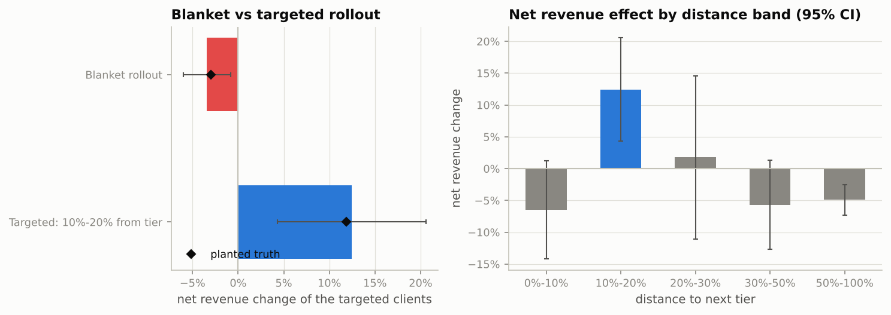</p>

## Contents

1. [The business problem](#1-the-business-problem)
2. [The experiment](#2-the-experiment)
3. [Results, decision by decision](#3-results-decision-by-decision)
4. [What I would tell the business](#4-what-i-would-tell-the-business)
5. [Trust: replication, calibration, honesty](#5-trust-replication-calibration-honesty)
6. [Methods and the course they come from](#6-methods-and-the-course-they-come-from)
7. [Learning write-ups](#7-learning-write-ups)
8. [How to run it](#8-how-to-run-it)
9. [Repository layout](#9-repository-layout)
10. [Limitations and next steps](#10-limitations-and-next-steps)

## 1. The business problem

An institutional exchange charges trading fees in basis points on a tiered schedule: the more a
client trades per quarter, the lower the rate. The illustrative schedule in
`configs/default.yaml`:

| Tier | Quarterly volume | Maker | Taker |
|---|---|---|---|
| Starter | < $25M | 8 bps | 14 bps |
| Standard | ≥ $25M | 7 bps | 12 bps |
| Professional | ≥ $100M | 6 bps | 10.5 bps |
| Enterprise | ≥ $500M | 5 bps | 9 bps |

A client's blended rate depends on their maker/taker mix. Many clients sit a little below a
threshold without knowing it. The **Tier Accelerator** campaign has two variants:

* **Nudge**: show the client a progress bar to the next tier (information only).
* **Incentive**: the progress bar plus a *half-step* discount toward the next tier's rate for
  the quarter; clients who reach the threshold get the full next-tier rate.

The tension is mechanical: if clients trade more, revenue goes up (good); if they trade at a
lower rate, or cross into a cheaper tier, revenue per dollar goes down (bad). "Did revenue go
up?" is therefore the wrong first question. The right ones are *for whom* the volume gain pays
for the rate cut, and *for how long*.

## 2. The experiment

**Population.** 5,000 clients across six segments (hedge funds, market makers, asset managers,
corporate treasuries, family offices, prop desks) with a log-normal volume distribution
(median $45M/quarter, heavy right tail), a maker/taker mix, API share, dashboard engagement,
tenure, an account-manager flag, and a 13-week pre-period of weekly volume.

**Design.** A multi-cell randomised experiment with a holdout: **holdout 30% / nudge 30% /
incentive 40%**, assigned by stratified permuted blocks on tier × distance bucket × segment.
13 experiment weeks, then 26 weeks of follow-up during which the holdout is *kept*, so the
effect can be tracked for 39 weeks. Sample-ratio-mismatch and balance checks pass
(`results/srm.json`, `results/balance.csv`).

**Outcomes.** Quarterly volume, blended rate and revenue (= volume × rate) per client;
weekly volume for 39 weeks; and, for treated clients, the week their engagement with the
campaign lapsed (last progress-bar view or email click), right-censored at week 39.

**Planted truth.** The simulator draws each client's outcomes under *every* cell with shared
noise, so each client has a true individual treatment effect. The incentive lifts volume by
~8% for clients within 10% of a threshold (they would mostly cross anyway), ~30% for clients
10–20% away, ~6% at 20–40%, ~3% beyond; the lift is larger for engaged clients and smaller for
API-driven flow; it disappears when engagement lapses (a 2%/week hazard, slower with an
account manager, faster for API-heavy clients). Three market confounders (a volatility spike,
a competitor promotion aimed at the Starter tier, a seasonal rally) are planted to make a
before/after comparison visibly wrong. Full detail: `configs/default.yaml` and
[`docs/learn/01_potential_outcomes.md`](docs/learn/01_potential_outcomes.md).

**Data-quality gates.** Nine checks run before any analysis (unique clients, SRM, strata
shares, covariate balance, revenue = volume × rate, observed outcome = potential outcome of
the assigned cell, weekly sums, no post-treatment features, no pre-period leakage); blocking
failures stop the pipeline. `results/data_quality_checks.csv`.

## 3. Results, decision by decision

Each subsection: the question, the method and why, the result, and the decision it supports.
Figures are in `reports/figures/`, tables in `results/`, and every number here is read from
those files.

### 3.1 Could this experiment detect anything? Power and the case for CUPED

Raw quarterly revenue has a coefficient of variation of about 2.5, so the minimum detectable
effect on the incentive-vs-holdout contrast is **11.6%** of revenue at 80% power. The pre-period
revenue predicts the experiment-period revenue with ρ = 0.71, so CUPED (subtracting θ × the
pre-period deviation) cuts the variance by ρ² ≈ **52%** and the MDE to **7.9%**: the same
precision as an experiment 2.2× the size. `results/power.csv`,
[`notebooks/01_power_and_design.ipynb`](notebooks/01_power_and_design.ipynb).

### 3.2 The average effect: four estimators, one answer

| Estimator (incentive vs holdout) | Relative effect | 95% CI | Variance vs diff-in-means |
|---|---|---|---|
| Difference in means | −4.6% | [−12.4, +3.2] | 1.00 |
| **CUPED** | −4.7% | [−10.2, +0.9] | **0.48** |
| Lin (2013) regression, HC2 | −2.8% | [−7.5, +1.9] | 0.34 |
| **AIPW**, cross-fitted gradient boosting | **−3.4%** | **[−6.0, −0.8]** | **0.11** |
| *Planted truth* | *−3.0%* | | |

<p align="center">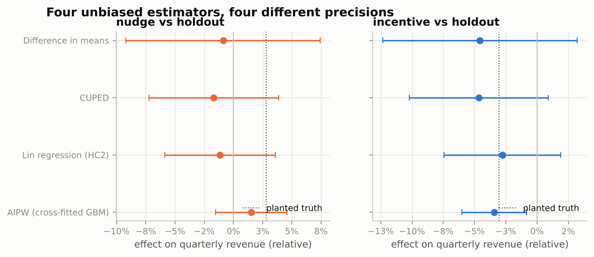</p>

The point estimates agree; the intervals shrink as each estimator uses more pre-treatment
information (CUPED: one covariate; Lin: all covariates, linearly; AIPW: all covariates through a
flexible outcome model, cross-fitted so it cannot overfit the correction). AIPW is the
estimator the business case uses; the simulator assumes CRM covariates explain most of the
quarter-to-quarter drift, which is what makes it this much tighter than CUPED
(`docs/DECISIONS.md` B2). The nudge cell's effect is +2.8% in truth and is not distinguishable
from zero by any estimator.

**Robustness.** Welch's t (p = 0.26), Mann–Whitney U (p = 0.40, probability of superiority
0.49) and a stratified permutation test with 5,000 draws (p = 0.15) agree that the *population*
effect of a blanket rollout is not detectable at this sample size, as the power analysis
predicted; Holm-corrected p-values across the two cells are in `results/multiple_testing.json`.
The project does not pretend otherwise: the decision-relevant estimates are the targeted ones
below. [`02_cuped_and_regression_adjustment.md`](docs/learn/02_cuped_and_regression_adjustment.md),
[`03_robustness_tests.md`](docs/learn/03_robustness_tests.md).

### 3.3 What if we had not randomised?

The same potential outcomes, but clients *opt in* the way they would if the campaign simply
launched with a sign-up button (engaged, growing, near-tier clients opt in more). True ATE
on these clients: −$1.8K per client.

| Estimator | Estimate | Across 10 opt-in draws: RMSE / 95% coverage |
|---|---|---|
| Naive difference in means | +$24.6K ± 2.2K | $16.3K / 0% |
| Regression adjustment (linear) | −$3.9K ± 4.3K | $1.4K / 90% |
| IPW (logistic propensity) | +$10.9K ± 3.1K | $6.0K / 100% |
| AIPW (cross-fitted) | +$0.6K ± 0.5K | $2.3K / 90% |

<p align="center">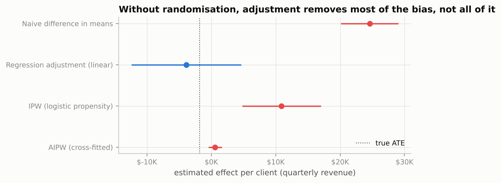</p>

The naive estimate has the wrong sign and is 13× the effect. Adjustment removes most of the bias;
AIPW removes 91% of it in this draw but its interval still misses, because one $2M-revenue
client in a low-propensity cell dominates the correction term, and the influence-function SE
does not know how rare that was. Over repeated draws AIPW is unbiased with 90% coverage. The
lesson the project draws: an observational estimate of a 3% effect on a heavy-tailed outcome
is fragile even with every confounder measured, and the RCT's intervals are both tighter and
assumption-free. [`04_propensity_ipw_aipw.md`](docs/learn/04_propensity_ipw_aipw.md).

### 3.4 Who responds? The uplift benchmark

Six learners estimate each client's conditional average treatment effect τ(x) from
pre-treatment features only (`src/tierlift/features.py`): the **S-, T- and X-learners**
(Künzel et al.), the **R-learner** (Nie & Wager; `NonParamDML`), the **DR-learner** (Kennedy;
`DRLearner`) and **`CausalForestDML`** (Athey, Tibshirani & Wager), all from EconML with
gradient-boosting nuisance models, the known propensity, and 4-fold × 2-repeat cross-fitting
so every score is out-of-fold. The outcome is the *revenue index* (experiment revenue /
pre-period revenue); in dollars every learner spent its capacity on client size
([`05_meta_learners_s_t_x.md`](docs/learn/05_meta_learners_s_t_x.md) §5.6).

| Model | Qini | AUUC | RATE (AUTOC) | BLP slope | Rank corr. with truth (oracle) | PEHE (oracle) | Fit time |
|---|---|---|---|---|---|---|---|
| **CausalForestDML** | **0.0134** | **0.0234** | **0.071** (p = 0.001) | 1.91 | **0.70** | 0.092 | 45 s |
| X-learner | 0.0108 | 0.0188 | 0.068 (p = 0.004) | 0.71 | 0.45 | 0.105 | 10 s |
| S-learner | 0.0106 | 0.0185 | 0.069 (p = 0.001) | 1.70 | 0.66 | **0.090** | 3 s |
| T-learner | 0.0066 | 0.0117 | 0.039 (p = 0.07) | 0.55 | 0.39 | 0.129 | 5 s |
| R-learner | 0.0064 | 0.0112 | 0.034 (p = 0.12) | 0.63 | 0.36 | 0.144 | 29 s |
| DR-learner | 0.0059 | 0.0104 | 0.020 (p = 0.25) | 0.46 | 0.35 | 0.148 | 15 s |
| *Oracle ranking (knows the truth)* | *0.0206* | *0.0357* | | | *1* | *0* | |

<p align="center">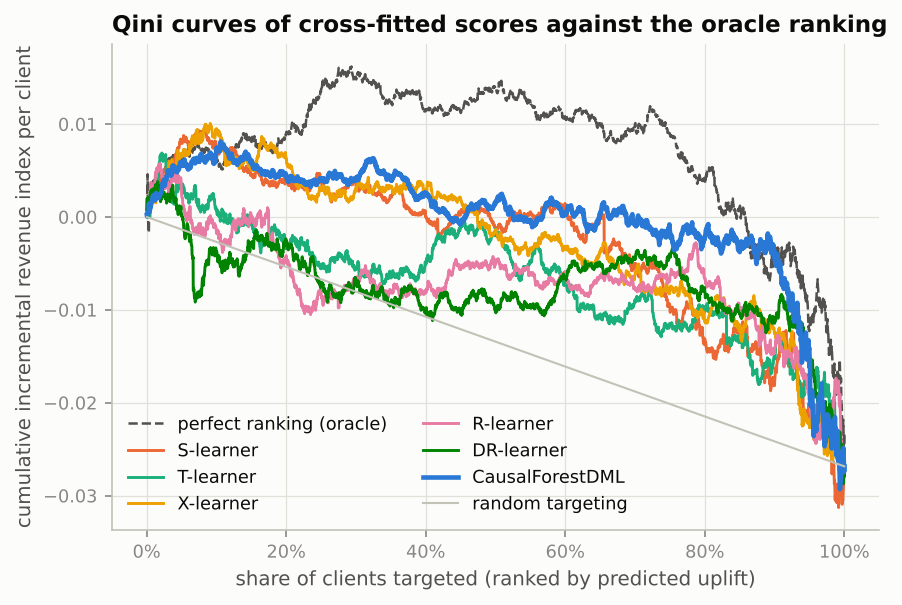</p>
<p align="center">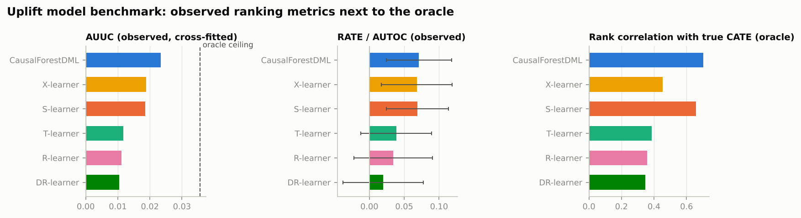</p>

**Reading it.** Qini and AUUC measure how much incremental revenue the model's ranking captures
over random targeting; RATE (Yadlowsky et al.) is the same idea with a bootstrap test; the BLP
slope (Chernozhukov et al.) is the regression of true on predicted effect, 1 = calibrated. The
oracle columns exist only because this is a simulation and are labelled as such: their job is
to check that the observed metrics pick the right winner. They do: the forest is first on every
observed and oracle metric, reaching two thirds of the AUUC ceiling with 3,500 clients, and
the forest and the S-learner are the only two whose heterogeneity is significant (BLP slope
≈ 1.7–1.9: calibrated-but-timid, which is what honest regularisation looks like). The
T/X/R/DR-learners over-spread their estimates (slope 0.5–0.7).

**Stability.** Across five full replications with reduced settings
(`results/benchmark_montecarlo_summary.csv`), the forest is first by rank correlation with the
truth in *all five*; the observed AUUC leaderboard, which sees one noisy outcome per client,
reorders between seeds (the S-learner is first by AUUC in three of five, with an across-seed
SD as large as the mean). The honest summary is that the forest is the most reliable at
recovering the true ranking, the S-learner is the strongest meta-learner on this data, and a
single-run leaderboard should be read with its RATE standard errors.
[`06_orthogonal_learners_r_dr.md`](docs/learn/06_orthogonal_learners_r_dr.md),
[`07_causal_trees_and_forests.md`](docs/learn/07_causal_trees_and_forests.md),
[`08_evaluating_uplift_qini_auuc_rate.md`](docs/learn/08_evaluating_uplift_qini_auuc_rate.md).

<p align="center">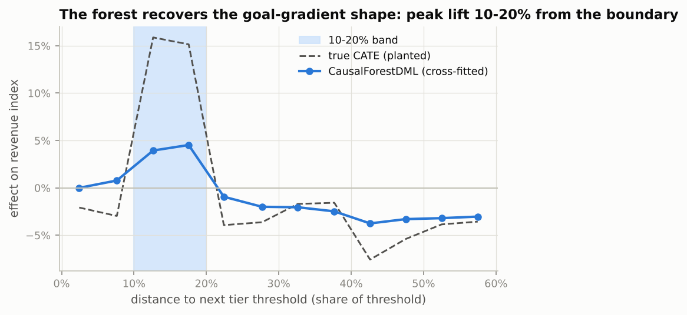</p>

The forest's out-of-fold scores against distance to the next tier recover the planted shape:
a hump at 10–20%, little within 10%, little beyond.

### 3.5 From scores to a decision: policy values

A CATE is not a decision. Each candidate policy (treat everyone; the hand-written "10–20% from
tier" rule; "τ̂ > 0" for each learner; a depth-2 policy tree) is scored with the *same*
cross-fitted doubly robust scores Γᵢ, so V̂(π) = mean(π(xᵢ) Γᵢ) is unbiased for any rule that
depends on pre-treatment features (course video 19). `results/policy_comparison.csv`, in
quarterly net revenue per client in the population:

| Policy | Value / client | Share targeted |
|---|---|---|
| Blanket rollout | −$2,209 ± 904 | 100% |
| Rule: 10–20% from tier | +$550 ± 201 | 8% |
| CATE > 0: S-learner | +$645 ± 167 | 18% |
| CATE > 0: CausalForestDML | +$593 ± 164 | 20% |
| CATE > 0: T / X / R / DR-learner | +$170 … −$449 (SE ≈ 450–530) | 36–40% |
| Policy tree (depth 2), in-sample | +$642 ± 207 | 19% |
| Policy tree (depth 2), cross-fitted | −$886 ± 605 | 37% |

<p align="center">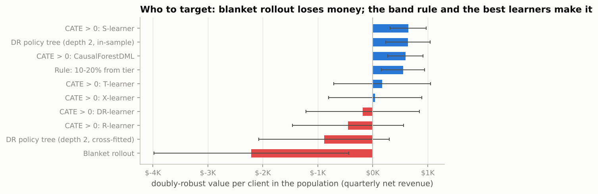</p>

Two things to take from it. The simple rule is within one standard error of the best learned
rule and fits on one line of a product spec. And the policy tree, which looks as good as the
forest when scored on the clients it was grown on, is worthless when grown on half the clients
and scored on the other half: with 3,500 clients a shallow tree is not stable, and the gap
between its two rows is the clearest illustration in the project of why evaluation must be
honest. [`09_policy_learning.md`](docs/learn/09_policy_learning.md).

### 3.6 Volume effect vs rate compression

Revenue is volume × rate, so for any group ΔR = (V₁ − V₀)·r₀ + V₀·(r₁ − r₀) + (V₁ − V₀)(r₁ − r₀):
the extra trading priced at the old rate, the old trading repriced at the new rate, and the
extra trading's own discount. It is an exact identity (a test checks it to 1e-12). Arm means
are AIPW-adjusted so that a whale landing in one arm does not drive a bucket
(`results/decomposition_incentive_adjusted.csv`; the raw version is alongside):

| Distance to next tier | Volume lift | Rate change | Volume effect | Rate effect | Net | Truth |
|---|---|---|---|---|---|---|
| Within 10% | +0.3% | −8.3% | +$0.2K | −$5.4K | **−8.0%** | −3.9% |
| **10–20%** | **+29.6%** | −10.3% | **+$17.6K** | −$6.1K | **+16.3%** | +11.8% |
| 20%+ | +4.6% | −8.0% | +$2.8K | −$4.9K | **−3.8%** | −4.4% |

<p align="center">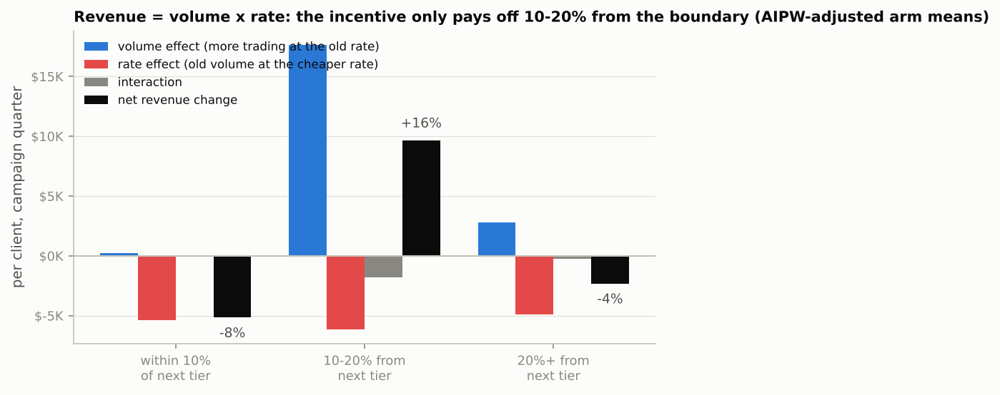</p>

The rate effect is negative everywhere and roughly the same size; what varies is the volume
effect. Within 10% the clients cross anyway, so the exchange gives up the full next-tier rate
for no extra volume. Beyond 20% the half-step discount applies to everyone and the lift is
small. Only the 10–20% band has a volume gain that pays for its rate cut.
[`10_revenue_decomposition.md`](docs/learn/10_revenue_decomposition.md).

### 3.7 Blanket vs targeted rollout

AIPW influence scores are fitted once on the whole incentive-vs-holdout sample and averaged
over the clients each policy targets; because membership is pre-treatment, randomisation holds
inside the subgroup and the estimate is unbiased, and because the nuisance models saw all 3,500
clients rather than 290, its standard error is half that of refitting inside the band
(`docs/DECISIONS.md` E3). `results/rollout.csv`:

| Policy | Clients | Net revenue change of targeted clients | 95% CI | Truth | Quarterly impact (truth) | Rate compression cost (truth) |
|---|---|---|---|---|---|---|
| Blanket rollout | 5,000 | **−3.4%** | [−6.0, −0.8] | −3.0% | −$10.6M (−$9.1M) | −$22.2M |
| Targeted: 10–20% from tier | 408 | **+12.5%** | [+4.3, +20.6] | +11.8% | +$3.1M (+$2.9M) | −$2.3M |

The band sweep (`results/targeting_band_grid.csv`, right panel of the first figure) shows the
sweet spot is a *band*: 0–10% is −6.5%, 10–20% is +12.5% with a CI that excludes zero, 20–30%
is +1.8% ± 13, 30–50% is −5.7%, and beyond 50% is −4.9% with a CI that excludes zero. CUPED
inside the band gives +9.1% with a CI from −10% to +28%: the same answer, too imprecise to
act on, which is the practical reason the doubly robust machinery is here.

### 3.8 Does the effect last? Survival analysis and the ROI correction

<p align="center">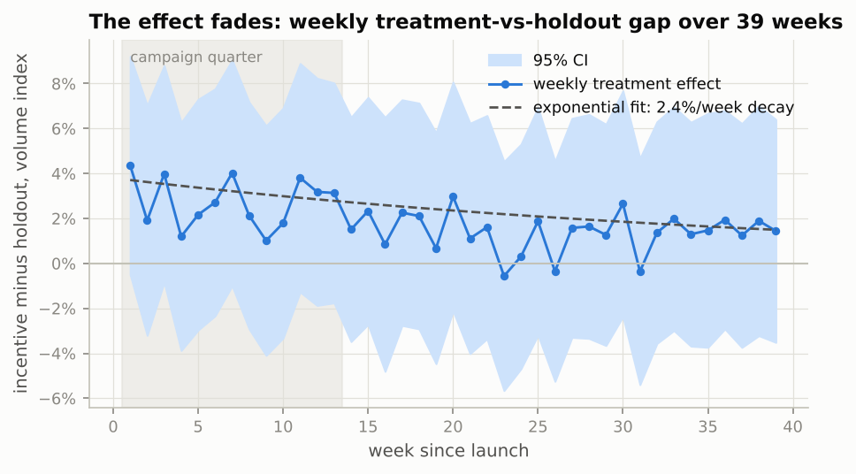</p>

The weekly incentive-vs-holdout gap over 39 weeks decays; a log-linear fit gives 2.4% ± 0.5%
per week, but the curve is noisy (the population lift is ~5% against weekly noise of 20–35%).
The per-client engagement-lapse event is the better instrument: it is a textbook
time-to-event with right-censoring, and Kaplan–Meier handles the censoring that a naive
"average weeks engaged" would get wrong.

<p align="center">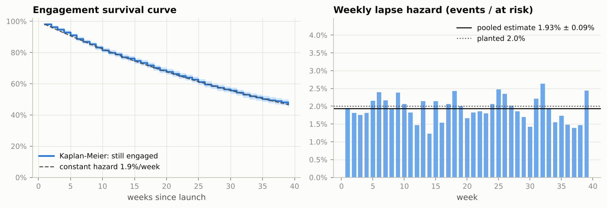</p>

The weekly hazard is flat at **1.93% ± 0.04%** (planted 2.0%), so decay is memoryless with a
half-life of about 36 weeks. A Cox proportional-hazards model says who lapses fastest
(`results/cox.csv`, hazard ratios per SD): account manager **0.87**, dashboard engagement
**0.82**, API share **1.12**, tenure 0.98 (n.s.). Durability can be bought with a relationship
touch for API-heavy clients.

<p align="center">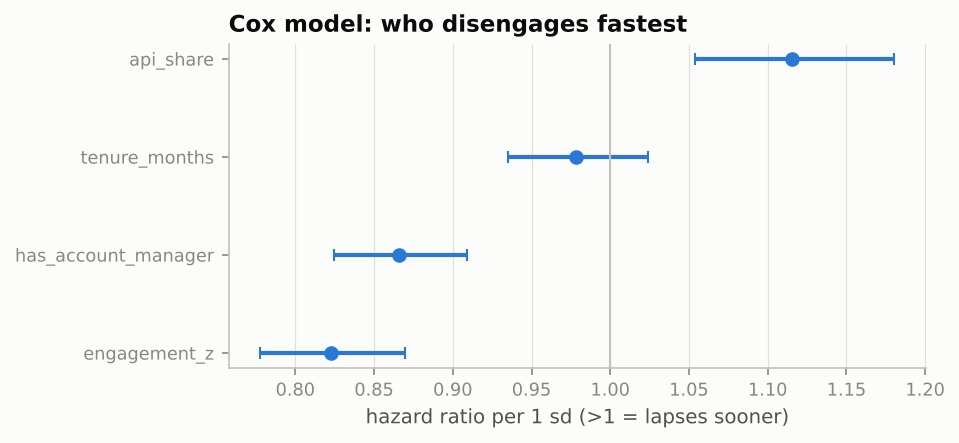</p>

**ROI.** Naive annualisation multiplies the quarter by four. Two things are wrong with it: the
quarter's average already contains 13 weeks of decay, and the next 39 weeks decay further.
With m(H) = (1 − (1 − h)^H)/(hH), the naive-to-true ratio is m(13)/m(52) = **1.41** at h = 1.93%:
the naive annual benefit of the targeted rollout ($25.8M volume gain) is 41% above the
decay-adjusted one ($18.4M). The rate-compression cost (−$10.0M) does *not* decay, since a
client who crossed keeps the cheaper tier, so the **net** projection is overstated by 90%:
$15.8M naive vs $8.3M adjusted. `results/roi_projection.csv`,
[`11_survival_decay_and_roi.md`](docs/learn/11_survival_decay_and_roi.md).

<p align="center">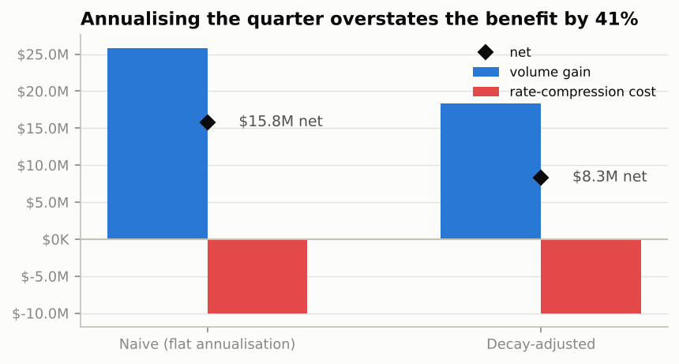</p>

## 4. What I would tell the business

1. **Do not roll the incentive out to everyone.** The experiment's best estimate is −3.4% net
   revenue (CI excludes zero), because the rate cut lands on 4,000 clients who would not have
   changed their trading.
2. **Target clients 10–20% below the next tier.** On those ~8% of clients the incentive is worth
   about +12% of their net revenue, roughly +$3M a quarter at this book size; the band rule is
   as good as the best learned policy and can be written into a product spec in one line.
   The forest's refinement (prefer taker-heavy clients) is worth testing in the next cell.
3. **Budget with decay.** A 2%/week engagement lapse means the first-year benefit is about 70%
   of the "quarter × 4" number and the net is about half. Account-manager outreach to
   API-heavy clients is the lever on durability.
4. **Keep the holdout.** The 26-week follow-up is what made the decay measurable; the
   confounders planted in the simulator show how wrong a before/after read would have been.

## 5. Trust: replication, calibration, honesty

**Monte Carlo over 40 seeds** (`tierlift montecarlo`; `results/montecarlo_summary.csv`): the
whole experiment is re-simulated and re-analysed 40 times with different seeds.

| Target | Estimator | Mean truth | Mean estimate | SD of estimates | Mean reported SE | 95% CI coverage |
|---|---|---|---|---|---|---|
| Blanket | CUPED | −2.9% | −2.3% | 2.8% | 2.8% | 95% |
| Blanket | AIPW | −2.9% | −2.7% | 1.3% | 1.4% | 95% |
| Band 10–20% | CUPED | +11.0% | +12.6% | 11.1% | 9.3% | 90% |
| Band 10–20% | AIPW | +11.0% | +13.0% | 5.5% | 4.7% | 95% |

The reported standard errors match the spread of the estimates and the intervals cover the
truth at the nominal rate; the band's ratio estimate runs about two points high on average (a
small-sample property of ratio estimators, documented rather than hidden). CUPED's variance
reduction is 51% ± 3% and the lapse hazard 1.95% ± 0.04% across seeds. The run used for
the figures (seed 13) is the one whose band estimate is closest to the median of the 40, a
rule in the code (`pick_showcase_seed`) that never looks at the planted truth, so the figures
show a typical run rather than a lucky one.

**What the single run does not show, said plainly.** The population-level effect is not
significant at this sample size (section 3.2); the band's interval is wide (+4% to +21%);
the observational AIPW misses in this draw (3.3); the uplift leaderboard's middle reorders
between seeds (3.4); the policy tree is unstable (3.5). Each of these is in the results
tables, in the figures and in the write-ups, because a project whose every number came out
clean would not be believable.

## 6. Methods and the course they come from

The project follows Stanford's *Machine Learning & Causal Inference: A Short Course* (Athey,
Wager et al.; [YouTube playlist](https://youtube.com/playlist?list=PLxq_lXOUlvQAoWZEqhRqHNezS30lI49G-)).

| Course section | Concept | Where it is used |
|---|---|---|
| 1–2. ML for prediction vs estimation; sample splitting | Cross-fitting; prediction ≠ causal estimation | Every nuisance model is cross-fitted (`aipw_scores`, `fit_crossfit`, `dr_scores`); write-up 4 §4.5 |
| 3. Potential outcomes, ATE, propensity scores, double robustness | ATE, CUPED/regression adjustment, IPW, AIPW, overlap | `experiment/ate.py`, `experiment/robustness.py`, `experiment/observational.py`; write-ups 1–4 |
| 3. Randomisation | Stratified assignment, SRM, balance, power, MDE | `simulate/assignment.py`, `experiment/design.py`; write-up 1 §1.5, notebook 01 |
| 4. Heterogeneous effects, trees and forests | CATE, causal forest, honest estimation | `CausalForestDML` in `uplift/learners.py`; write-up 7 |
| 5. Meta-learners, R-learner, orthogonalisation | S/T/X, R-learner (NonParamDML), DR-learner | `uplift/learners.py`; write-ups 5, 6 |
| 6. Validating HTE models | Qini/AUUC, RATE/TOC, BLP calibration, oracle checks | `uplift/evaluate.py`; write-up 8 |
| 6. Policy learning | Doubly robust policy value, policy trees, honest evaluation | `uplift/policy.py`; write-up 9 |
| (applied) | Revenue decomposition, rollout economics | `economics/`; write-up 10 |
| (applied) | Survival analysis: KM, hazard, Cox PH; decay-adjusted ROI | `durability/`; write-up 11 |

## 7. Learning write-ups

One per method in `docs/learn/`, each with the intuition, a worked example small enough to do by
hand, the math, where it shows up in the results, the pitfalls, and exercises with answers.

| # | Write-up | What you will be able to do afterwards |
|---|---|---|
| 1 | [Potential outcomes, ATE, CATE](docs/learn/01_potential_outcomes.md) | Say precisely what "the effect of the incentive" means and why one client's effect is unobservable |
| 2 | [CUPED and regression adjustment](docs/learn/02_cuped_and_regression_adjustment.md) | Explain where CUPED's variance reduction comes from and derive θ |
| 3 | [Welch's t, Mann–Whitney, permutation, Holm](docs/learn/03_robustness_tests.md) | Say what question each test answers and why they can disagree |
| 4 | [Propensity scores, IPW, AIPW, double robustness](docs/learn/04_propensity_ipw_aipw.md) | Read an AIPW formula and know which model's failure it survives |
| 5 | [S-, T-, X-learners](docs/learn/05_meta_learners_s_t_x.md) | Predict which meta-learner wins from the shape of the problem |
| 6 | [R-learner and DR-learner](docs/learn/06_orthogonal_learners_r_dr.md) | Explain orthogonalisation and why residual-on-residual works |
| 7 | [Causal forests](docs/learn/07_causal_trees_and_forests.md) | Explain honest splitting and what a forest's leaf estimates |
| 8 | [Qini, AUUC, RATE, BLP calibration](docs/learn/08_evaluating_uplift_qini_auuc_rate.md) | Score an uplift model without knowing anyone's true effect |
| 9 | [Policy learning](docs/learn/09_policy_learning.md) | Turn CATEs into a targeting rule and value it honestly |
| 10 | [Revenue decomposition](docs/learn/10_revenue_decomposition.md) | Split a revenue change into volume and price effects, exactly |
| 11 | [Survival analysis and decay-adjusted ROI](docs/learn/11_survival_decay_and_roi.md) | Handle censoring, read a hazard ratio, correct an annualised number |

The notebooks (`notebooks/00`–`05`) walk the same path with the real tables, and end with
questions to check understanding.

## 8. How to run it

```bash
git clone https://github.com/hrootscraft/revenue-tier-and-churn-experiment
cd revenue-tier-and-churn-experiment
python3.11 -m venv .venv && source .venv/bin/activate     # Python 3.10–3.12
pip install -e ".[dev]"

make test        # unit tests on a 1,200-client simulation, ~1 min
make all         # full pipeline: data/, results/, reports/figures/, ~3.5 min on 4 cores
make notebooks   # execute the six notebooks against results/
tierlift montecarlo --n-seeds 40                            # estimator calibration, ~2 min
tierlift montecarlo --benchmark --n-seeds 5 --workers 2     # leaderboard stability, ~3 min
```

`tierlift run-all --fast` runs every code path in about a minute (fewer permutations,
bootstraps and trees); CI runs it on every push. All tunable numbers are in
`configs/default.yaml`; `load_config(seed=…, population={"n_clients": …})` overrides any of
them from Python.

## 9. Repository layout

```
configs/default.yaml        every tunable number: population, fee tiers, design, planted truth, analysis
src/tierlift/
  config.py                 typed, validated loader for the YAML
  fees.py                   tier schedule, blended rates, distance to the next tier
  features.py               the pre-treatment feature matrix every model shares
  simulate/                 population -> stratified assignment -> potential outcomes -> observed tables
  experiment/               ate.py (DiM, CUPED, Lin, AIPW), design.py (SRM, balance, power),
                            robustness.py (Welch, Mann-Whitney, permutation, Holm),
                            observational.py (the no-randomisation counterfactual)
  uplift/                   learners.py (model zoo, cross-fitting), evaluate.py (Qini/AUUC/RATE/BLP/oracle),
                            policy.py (DR scores, policy value, policy tree)
  economics/                decomposition.py, rollout.py
  durability/               survival.py (KM, hazard, Cox), roi.py
  validation/checks.py      data-quality gates
  plots.py                  every figure (one palette, validated for colour-vision deficiency)
  pipeline.py               run_all(): results/ and reports/figures/ from one call
  montecarlo.py             replication over seeds; showcase-seed rule
  cli.py                    tierlift run-all | simulate | montecarlo
notebooks/00..05            narrative walk-through; imports everything from src/
docs/learn/01..11           the write-ups
docs/DECISIONS.md           every design choice, alternatives, and why
docs/SIMPLIFICATIONS.md     what a production exchange would add, and which way each gap biases
docs/CONTRIBUTING.md        setup, conventions, how to add a learner or a check
results/                    the tables quoted above (committed; `make all` regenerates)
reports/figures/            the 14 figures (committed)
tests/                      unit tests + one end-to-end test on a 2,000-client fast run
```

Engineering notes: typed frozen config; the truth table never reaches the observed tables (a
test asserts it); the feature matrix is pre-treatment only (a check fails the run otherwise);
every estimator returns the same `Estimate` record; `ruff` lint and format; GitHub Actions
runs lint, unit tests and the fast end-to-end test.

## 10. Limitations and next steps

* **It is a simulation.** The methods are real, the data is not; `docs/SIMPLIFICATIONS.md`
  lists eleven gaps (no interference between clients on a shared order book, quarterly rather
  than rolling tier windows, a single engagement-lapse event, and so on) with the direction of
  each bias.
* **The band estimate is wide.** +12.5% with a CI of +4% to +21% is enough to choose targeted
  over blanket, not enough to budget to the dollar; the next experiment should over-sample the
  band.
* **The policy tree is unstable at this sample size.** A production version would grow it on
  smoothed scores or restrict splits to actionable variables (write-up 9, exercise 5).
* **No churn or lifetime-value channel.** Clients who cross a tier may churn less; that is the
  natural next outcome to add, with the same holdout.
* **Next cells to test:** the forest's taker-heavy refinement; a relationship-manager touch for
  API-heavy clients as a durability intervention.
