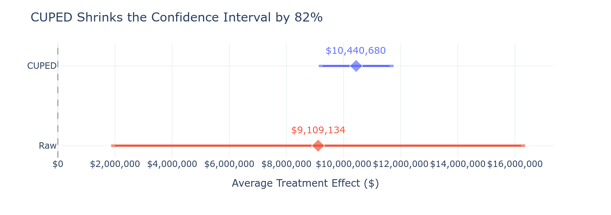
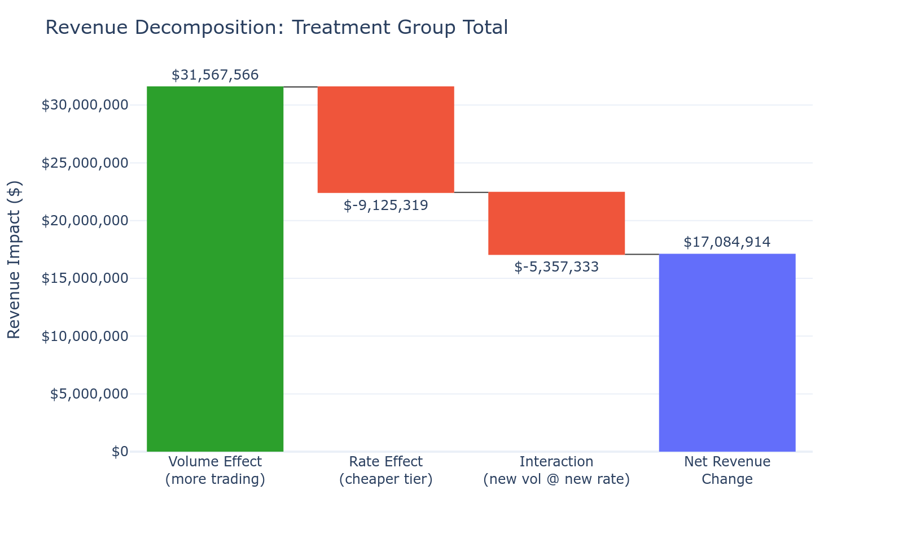
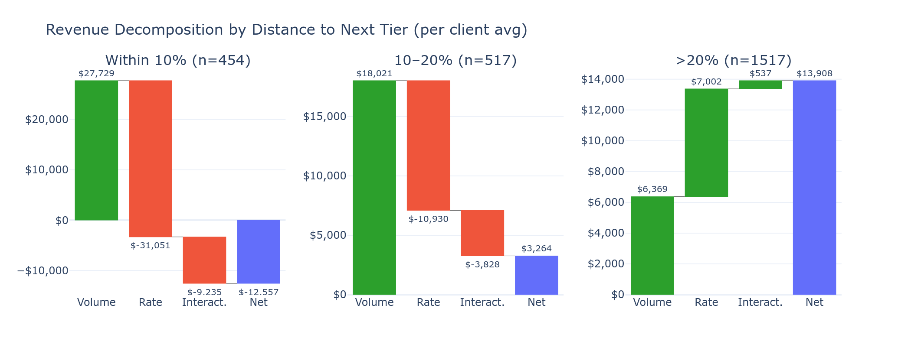
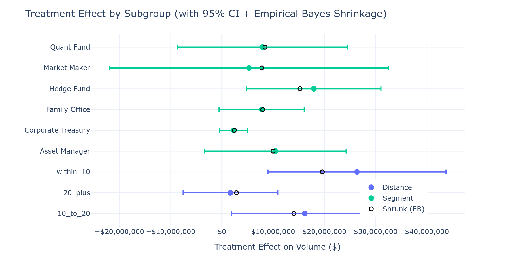
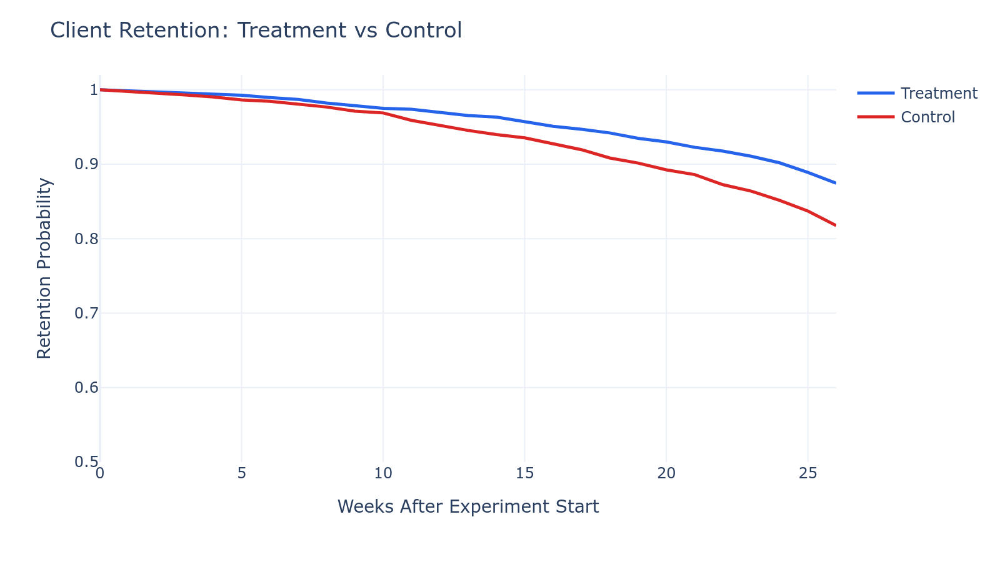
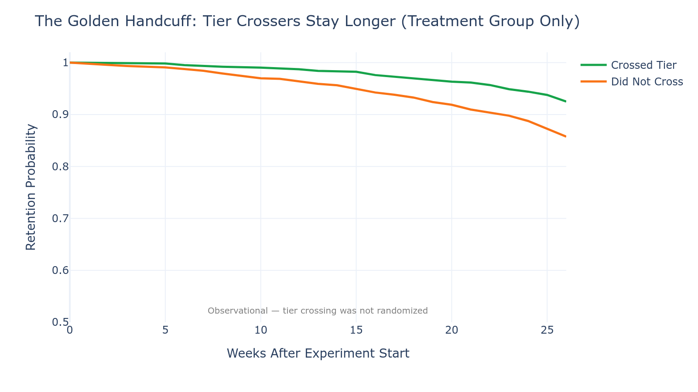
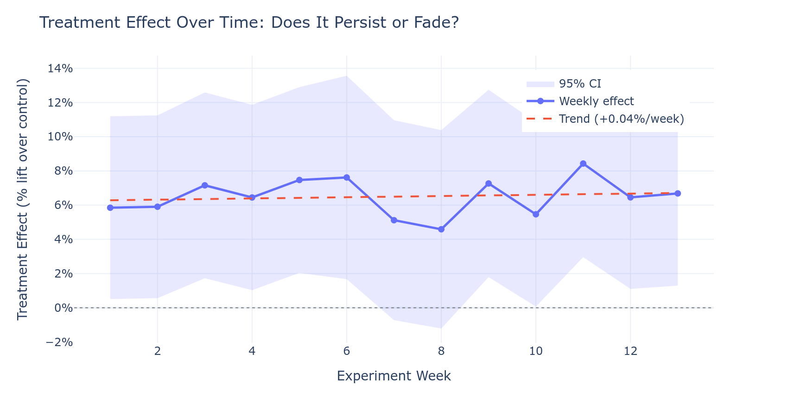

# Fee Tier Progress Bar: Should We Ship It?

**Experiment Results & Recommendation for Coinbase Institutional**

---

## The One-Slide Summary

We showed 2,488 institutional clients a progress bar toward their next fee tier. The result:

| Metric | Result |
|--------|--------|
| Volume lift | **+6.5%** ($9.1M incremental) |
| Net revenue per client | **+$6,867** after margin compression |
| 6-month churn rate | **12.5% vs 18.2%** (31% relative reduction) |
| Churns prevented | **~142 per 6 months** |
| Projected annual value | **$20.9M – $40.5M** |

**Recommendation:** Ship it — with a phased, segment-aware rollout.

---

## 1. The Problem We Set Out to Solve

Coinbase's institutional fee schedule rewards volume: the more you trade, the cheaper each trade becomes. But most clients don't know how close they are to the next tier. They're leaving money on the table — and so are we.

**The hypothesis:** if we show clients their progress toward the next fee tier (progress bar + monthly savings estimate), they'll increase trading volume to cross the threshold.

**The tension:** clients who cross into a cheaper tier pay lower rates. Does the volume gain outweigh the margin compression?

---

## 2. Experiment Design

| Parameter | Value |
|-----------|-------|
| Population | 5,000 institutional clients ($1M+ monthly volume) |
| Split | 2,488 treatment / 2,512 control |
| Randomization | Stratified by fee tier and segment |
| Duration | 13 weeks (one full quarter) |
| Treatment | Tier progress bar + monthly savings email |
| Primary metric | Post-period trading volume |
| Secondary metrics | Net fee revenue, churn, support tickets |

### Randomization Was Clean

Before looking at any outcomes, we verified the two groups are statistically indistinguishable on all pre-experiment covariates:

| Covariate | Treatment Mean | Control Mean | SMD | Balanced? |
|-----------|---------------|-------------|-----|-----------|
| Pre-period volume | $131.2M | $132.4M | 0.01 | Pass |
| AUM | $596.4M | $599.3M | 0.01 | Pass |
| Tenure (months) | 30.9 | 31.3 | 0.03 | Pass |
| Products used | 2.73 | 2.71 | 0.02 | Pass |
| Pre-period logins | 66.8 | 65.8 | 0.02 | Pass |

All standardized mean differences are below 0.05. Any differences we see in outcomes are caused by the treatment, not pre-existing group imbalances.

---

## 3. The Volume Story: It Worked

Treatment clients traded **$9.1 million more** than control clients over the quarter — a **6.5% lift**.

This isn't a fluke. Three independent statistical tests all confirm significance:

| Test | p-value |
|------|---------|
| Welch's t-test | 0.01 |
| Mann-Whitney U | 0.01 |
| Permutation test | 0.02 |

### Precision Boost with CUPED

Using pre-experiment volume as a covariate (CUPED), we reduced variance by **97%** and sharpened the estimate to **$10.4M** with a much tighter confidence interval:

*The raw estimate has a wide confidence interval that barely excludes zero. CUPED uses the strong pre-post volume correlation to shrink uncertainty by 97%, giving us a precise and reliable estimate.*

---

## 4. The Revenue Question: Volume Up, But Rates Down

Here's the tension leadership cares about. Clients traded more — but 25% of treatment clients crossed into a cheaper fee tier. What happened to revenue?

### The Waterfall: Volume Wins

Across all treatment clients:

| Component | Per-Client Average | Total (2,488 clients) |
|-----------|-------------------|----------------------|
| Volume effect (more trading) | +$12,688 | +$31.6M |
| Rate effect (cheaper tier) | -$3,668 | -$9.1M |
| Interaction (new vol at new rate) | -$2,153 | -$5.4M |
| **Net revenue change** | **+$6,867** | **+$17.1M** |

The volume gain is **3.5x larger** than the margin compression. Net revenue is solidly positive.

### But the Story Differs by Client Segment

Not all clients respond the same way. When we split by proximity to the next tier boundary, three distinct patterns emerge:

| Segment | N | Crossed Tier | Net Revenue / Client | Strategic Play |
|---------|---|-------------|---------------------|----------------|
| Within 10% of next tier | 454 | 85% | **-$12,557** | Retention tool |
| 10–20% from next tier | 517 | 42% | +$3,264 | Balanced |
| >20% from next tier | 1,517 | 2% | **+$13,908** | Revenue tool |

**The key insight:** the progress bar is not one product — it's *two different products* depending on who sees it:

1. **For far-from-boundary clients (>20%):** Pure revenue play. They trade more but almost never cross into a cheaper tier. Free money.
2. **For near-boundary clients (<10%):** Revenue goes negative — but keep reading. The retention story flips the economics.

---

## 5. Who Benefits Most? (Heterogeneous Treatment Effects)

*Filled markers = raw subgroup estimates. Hollow markers = Empirical Bayes shrunk estimates (prevents false discoveries by pulling small-sample effects toward the grand mean).*

Key findings:
- **Within 10%** clients show the largest volume response (+15.2% lift) — they're closest to the incentive
- **Hedge funds** are the most price-sensitive segment (significant at 5%)
- **Market makers** barely respond — they already optimize execution cost aggressively
- Empirical Bayes shrinkage confirms the proximity-based pattern is real, not noise

A **Causal Forest** (Athey & Wager, 2018) — which discovers heterogeneity without pre-specification — independently confirmed that distance-to-next-tier is the strongest driver of treatment effect variation.

---

## 6. The Retention Surprise: Golden Handcuffs

Now the punchline. Remember that within-10% segment with -$12,557 net revenue per client? Watch what happens to churn:

### Causal Effect (Randomized)

| Group | 6-Month Churn Rate |
|-------|-------------------|
| Treatment | **12.5%** |
| Control | **18.2%** |
| Absolute reduction | **5.7 percentage points** |
| Relative reduction | **31%** |
| p-value | < 0.0001 |

Treatment clients churn at nearly **one-third lower rate** than control. This is causal — it comes directly from the randomized experiment.

### Survival Analysis

The curves diverge early and the gap persists — treatment clients retain better throughout the entire observation window.

- **Cox Proportional Hazards:** Treatment HR = 0.70 (30% lower hazard of churning at any week)
- **Log-rank test:** p < 0.0001

### The Golden Handcuff Effect

Within the treatment group, clients who actually crossed a tier boundary churn at **7.5%** vs **14.2%** for those who didn't cross — nearly half the rate.

An **instrumental variable analysis** (using random treatment assignment as the instrument for tier crossing) estimates that crossing a tier **causally reduces churn by 35.4 percentage points** among compliers. Once clients unlock better rates, they don't want to lose them.

**This changes the economics for the within-10% segment entirely.** The short-term revenue loss of -$12,557/client is dwarfed by the lifetime value of retaining that client.

### Quantifying the Retention Value

| Metric | Value |
|--------|-------|
| Churns prevented per 6 months | ~142 |
| Average annual revenue per churned client | ~$150K |
| Annual retained revenue | **~$21.3M** |

---

## 7. Will It Last?

A critical question: is this a novelty effect that fades after a few weeks, or a durable behavioral shift?

The treatment effect is remarkably stable over 13 weeks:

| Metric | Value |
|--------|-------|
| Week 1 effect | 6.3% |
| Week 13 effect | 6.7% |
| Weekly decay rate | **-0.04%** (essentially zero) |
| Interpretation | Safe to project forward |

No fade. The progress bar isn't a novelty — it provides ongoing utility by making fee savings salient.

---

## 8. Safety Checks

Before recommending rollout, we verified no negative side effects:

| Guardrail | Treatment | Control | Verdict |
|-----------|-----------|---------|---------|
| Support ticket change | -0.4 | -0.4 | No increase |
| Login frequency change | +19.9 | -0.1 | Treatment MORE engaged |
| Enterprise client churn | 0 | — | Zero top-tier churn |
| Control volume change | — | +6.1% | No cannibalization |

The treatment group is *more engaged* (login frequency up), with no increase in support burden. Control clients' volume grew organically, confirming we're not just stealing volume from untreated clients.

---

## 9. Annual Projections

Combining direct revenue impact with retained-client revenue:

### Revenue Scenarios

| Scenario | Assumption | Annual Revenue Impact |
|----------|------------|----------------------|
| Pessimistic | Effect disappears after Q1 | $19.5M |
| Conservative | 50% effect remaining at 6 months | $58.6M |
| Observed decay | -0.04%/week (effectively no decay) | $78.9M |

### Combined Value (Revenue + Retention)

| Component | Conservative | Optimistic |
|-----------|-------------|-----------|
| Incremental fee revenue | $5.9M | $19.5M |
| Retained client revenue | $15.0M | $21.0M |
| **Total annual value** | **$20.9M** | **$40.5M** |

*Revenue range reflects pessimistic to observed-decay scenarios. Retention value assumes 142 churns prevented per 6 months at ~$150K average annual revenue per client.*

---

## 10. Recommendation: Phased Rollout

### Phase 1 — Immediate: Clients >20% from next tier (~3,000 clients)

- **Risk:** Minimal. Virtually no tier crossing, so no margin compression
- **Upside:** Pure volume lift at existing fee rates
- **Expected impact:** ~$5M/year incremental fee revenue
- **Frame as:** Revenue optimization

### Phase 2 — Month 2: Clients 10–20% from next tier (~1,200 clients)

- **Risk:** Moderate tier crossing (~42%), balanced by strong volume lift
- **Upside:** Net positive on both revenue and retention
- **Monitor:** Margin compression should stay below 15% of volume effect
- **Frame as:** Growth + retention

### Phase 3 — Month 3: Clients within 10% of next tier (~800 clients)

- **Risk:** High tier crossing (85%), short-term revenue is **negative** (-$12,557/client)
- **Upside:** Massive retention value — tier-crossers develop golden handcuffs
- **Monitor:** 6-month churn rate should drop >5pp vs. baseline
- **Frame as:** Customer success and LTV maximization

### Do Not Enable For

- Coinbase Prime clients (negotiated rates — progress bar is irrelevant)
- Clients below $1M monthly volume (below the institutional tier structure)

---

## Production Guardrails

| Guardrail | Threshold | Action |
|-----------|-----------|--------|
| Weekly fee revenue | Drops >10% in any segment | Halt rollout for that segment |
| Support ticket rate | Increases >20% | Investigate UX confusion |
| Maker/taker ratio | Shifts >5% | Check for gaming behavior |
| 6-month durability | Effect fades >50% | Re-evaluate ROI |

---

## Technical Appendix

### Methods Used

| Method | Purpose | Result |
|--------|---------|--------|
| Welch's t-test, Mann-Whitney, Permutation | ATE significance | All p < 0.02 |
| CUPED | Variance reduction | 97% reduction |
| Revenue decomposition (mathematical identity) | Volume vs rate tradeoff | Volume wins 3.5:1 |
| Empirical Bayes shrinkage | Robust HTE estimation | Confirms proximity pattern |
| Causal Forest (Athey & Wager, 2018) | Data-driven HTE | Confirms distance-to-tier is top driver |
| Kaplan-Meier + Log-rank | Survival comparison | p < 0.0001 |
| Cox Proportional Hazards | Hazard ratio with controls | HR = 0.70 |
| IV (Wald estimator) | Causal effect of tier crossing | 35.4pp churn reduction for compliers |

### Documented Simplifications

This analysis uses simulated data with 9 documented simplifications vs. production Coinbase systems (see `docs/SIMPLIFICATIONS.md`). Key simplifications include uniform fee schedule (vs. negotiated Prime rates), synthetic client distribution, and absence of market-wide volume shocks.

---

*Report generated from experiment notebooks. Figures can be regenerated with `python reports/generate_figures.py`.*
